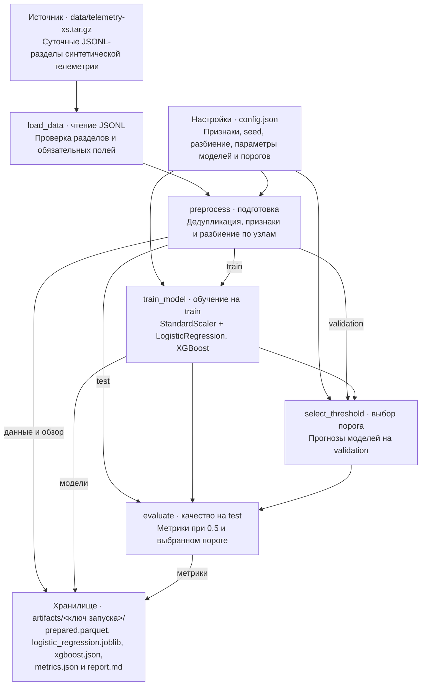

# Архитектура конвейера

JSONL-файлы читаются из архива по порядку дат. Все стадии выполняются одним процессом. Логи идут в стандартный поток ошибок. Конвейер формирует весь комплект во временной папке и публикует его одним переименованием в пределах выходной директории. Каталог с тем же ключом используется повторно.
