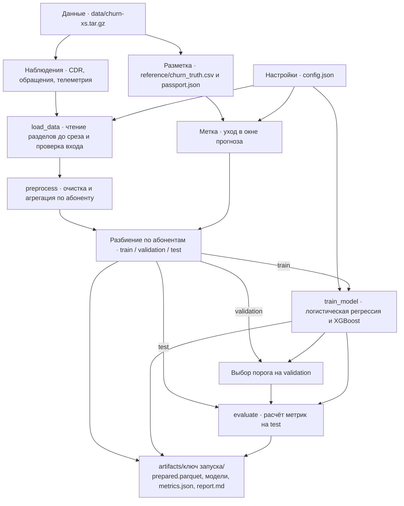

# Архитектура конвейера прогноза оттока

В признаках используются события до даты прогноза и CDR, уже полученные к этой дате. Даты ухода используются на стадии разметки. Все стадии выполняются в одном процессе, а комплект результатов публикуется после сохранения всех файлов.
